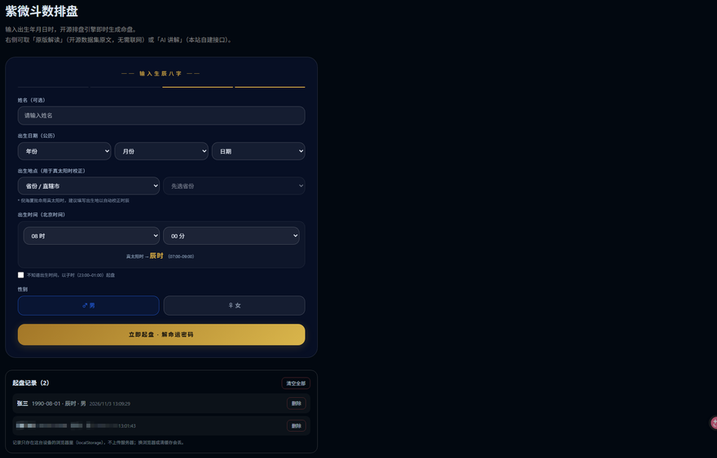
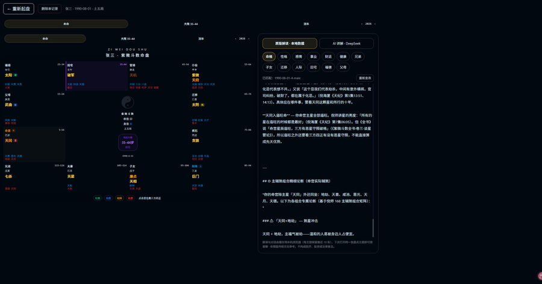

# 本站增补（相对上游 v4.0 Demo）

本仓库基于 [Renhuai123/ziwei-doushu](https://github.com/Renhuai123/ziwei-doushu)（MIT）。
上游的界面是**最小可运行 Demo**，且明确不含后端 API（`/api/interpret` 需要自己实现，断语库 `lib/ziwei/db-analysis.ts` 是占位）。
本仓库补齐了这部分，并且**不改动上游的排盘引擎**。

## 界面预览

| 排盘表单 + 起盘记录 | 原版解读 · 本地数据集 |
|---|---|
|  |  |

## 新增了什么

### 1. 原版解读 · 本地数据查表

`GET /api/dataset?y=&m=&d=&h=&g=`

按 key `YYYY-MM-DD-时辰序号-性别` 从作者开源的**解读数据集 v4.0**（674,976 张命盘 × 13 维，CC BY 4.0）取该盘的 13 维原文。
**不调用模型**，结果可复现、零额度消耗。

- 数据按年份分片（`year-YYYY.jsonl.zst`，约 2 MB/年），运行时按需下载到 `ZIWEI_DATA_DIR`（默认 `/data/cache`），不重分发
- 用镜像内置的 `zstd -d -c --long=27` 流式解压 + 命中即终止，首次约 15 s、之后约 2 s

### 2. AI 讲解 · 多轮追问

`POST /api/interpret`

把命盘压成**结构化简报**（基本信息 / 生年四化 / 十二宫含亮度与辅煞 / 当前大限与该限四化 / 健康取象）再交给任意 OpenAI 兼容模型。

设计要点：

- **每个主题（13 维）一条独立对话**，可连续追问；对话持久化在浏览器（每主题保留最近 10 条）
- 健康取象按倪师断法：**先找全盘杀星最集中的宫，再按该宫地支配脏腑**（子胆丑肝寅肺卯大肠辰胃巳脾午心未小肠申膀胱酉肾戌心包亥三焦），禁止用"某星五行直配脏腑"
- 煞星须分庙陷（入庙的煞星倪师认为"反而会变成吉星"），不作恐吓式表述
- 明确不预测生死灾祸、不作医疗/投资/法律建议
- ⚠️ 盘面简报**并入第一条 `user` 消息**，因为部分 CodeBuddy 类网关会静默丢弃 `role: system`

### 3. 起盘记录

`lib/history.ts`，纯前端 localStorage：

- 记录上限 50 条；同一「公历生日+时辰+性别」去重
- 解读结果（数据集原文 + AI 各主题对话）一并缓存，重开旧记录秒出、可继续追问
- 配额满时自动淘汰最旧盘的解读缓存（保留最近 20 份）

## 界面变化

`app/chart/page.tsx` 右侧原占位面板（上游 `InsightPanel`）替换为 `components/AiPanel.tsx`：

- 顶部两组开关：**原版解读 · 本地数据** / **AI 讲解 · DeepSeek**
- 13 个主题按钮常驻，换主题无需重新输入生日
- 点宫位时显示该宫的星曜/亮度/四化/辅煞，并作为 AI 提问的上下文
- 排盘页表单下方增加「起盘记录」列表（点开 / 删除 / 清空）

另外保留一个独立的 `/interpret` 页面（单页对话形态），适合只想想聊不想看图时用。

## 没有做什么

- 不包含断语库、账号/会员/支付、商业站前端（上游同样不开源）
- 不重分发数据集与倪师原话语料
- 未做服务端用户存储：记录与对话只在本机浏览器
